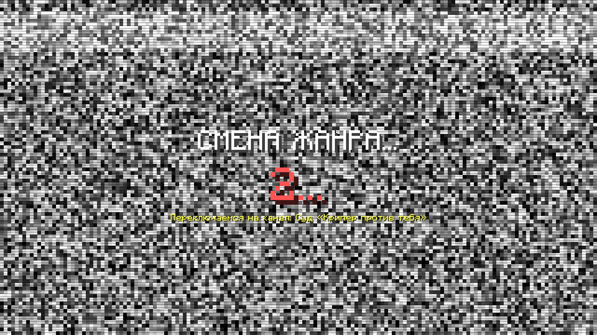
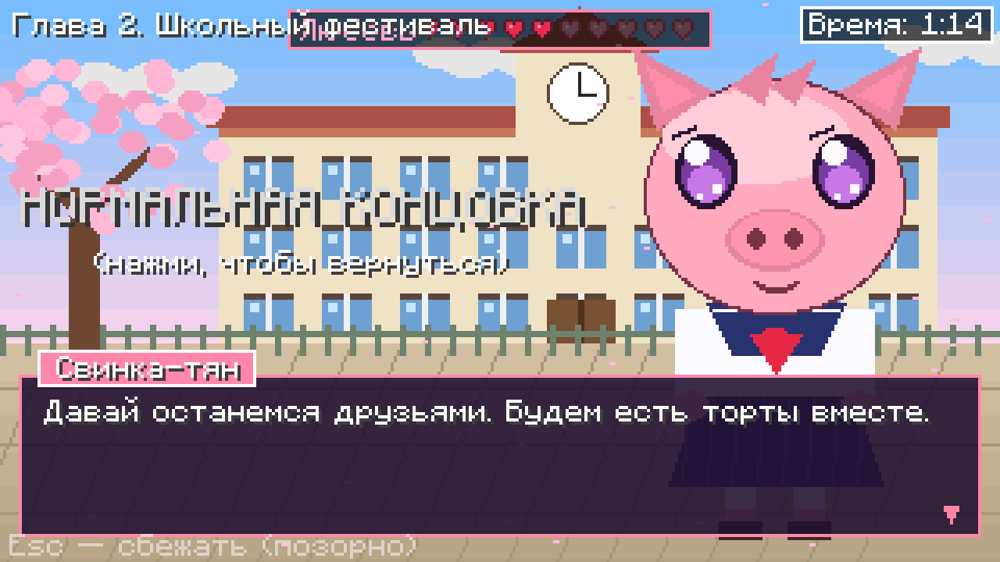
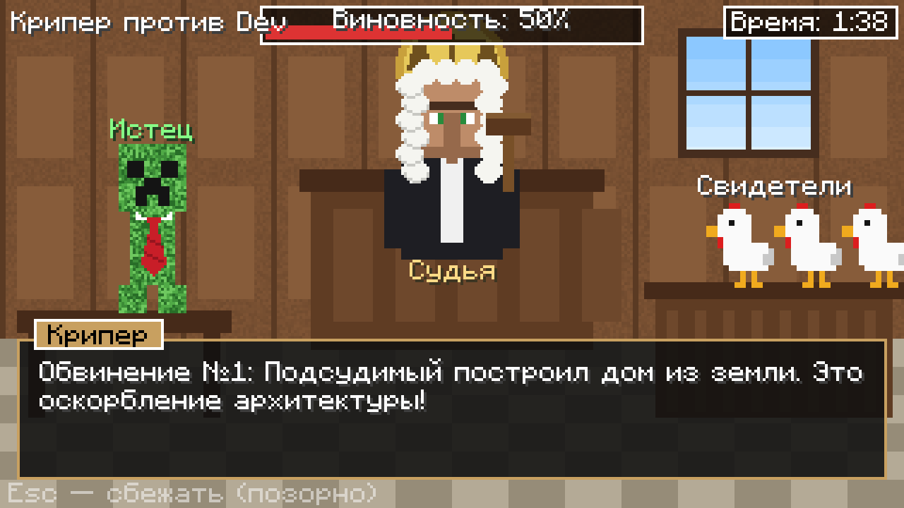
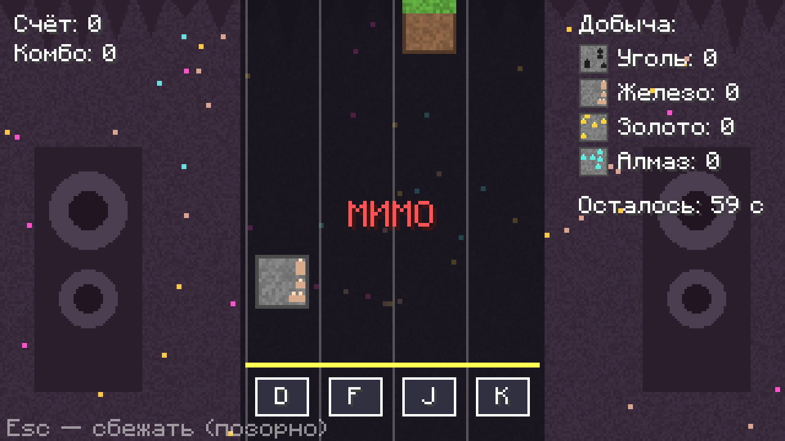
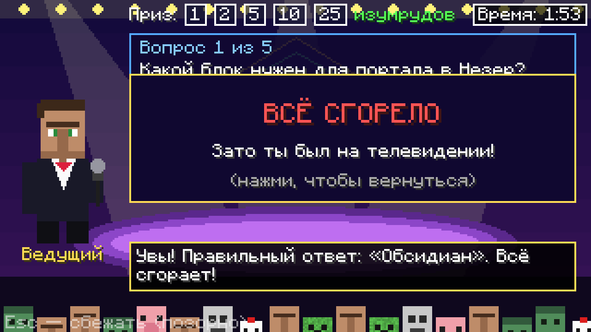
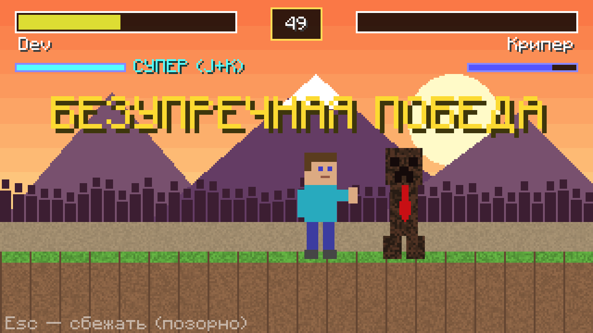
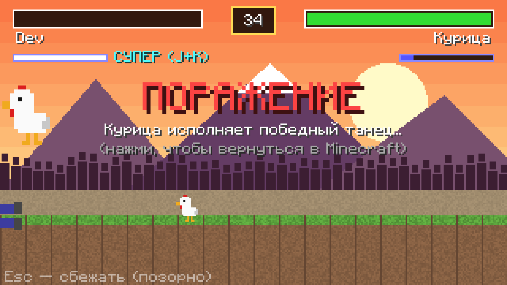
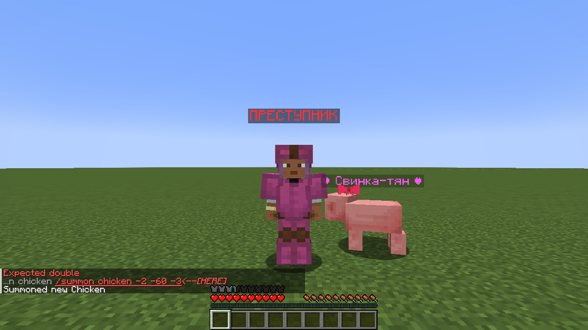

# Смена жанра 🎭

Мод для **Minecraft Java 1.20.1 + Forge 47+**. Раз в 20 минут Minecraft на 1–2 минуты превращается в другую игру: визуальную новеллу, суд, ритм-игру, викторину или файтинг. Потом возвращается обратно, а результат мини-игры влияет на мир. Задание — в [TZ.md](TZ.md).

⬇️ **[smena-zhanra-1.20.1-1.0.0.jar](https://github.com/abodubalay/claude-mod/raw/main/smena-zhanra/smena-zhanra-1.20.1-1.0.0.jar)** — положи в папку `mods`. На сервере мод нужен и серверу, и каждому игроку.

Команды (с читами): `/zhanr start novella` · `/zhanr start sud` · `/zhanr start ritm` · `/zhanr start viktorina` · `/zhanr start fighting` · `/zhanr random` · `/zhanr off` · `/zhanr on`.
Конфиг: `config/smenazhanra-common.toml` (интервал, включение жанров, длительность, побег по Esc).

Подробная инструкция и список проверок — в [source/КАК_УСТАНОВИТЬ.md](source/КАК_УСТАНОВИТЬ.md).

## Жанры

| Жанр | Управление | Что будет в мире |
|---|---|---|
| 💕 Новелла «Свинья моей мечты» (3 сценария) | мышь, 1–3 | хорошая концовка — бессмертная Свинка-тян с бантиком ходит за тобой; плохая — свиньи неделю убегают |
| ⚖️ Суд «Крипер против [ник]» (обвинения по твоей статистике) | мышь, 1–4 | оправдан — изумруды; виновен — на день розовая броня, кудахчущие курицы или надпись «ПРЕСТУПНИК» |
| 🎵 Ритм «Копай в такт» (60 с) | D F J K | алмазы, золото, железо, уголь — сколько поймал; или булыжник |
| 🎤 Викторина (37 вопросов, 3 подсказки) | мышь, 1–4 | изумруды 1 → 2 → 5 → 10 → 25 |
| 🥊 Файтинг «Куриный Комбат» | A/D, W, J, K, J+K | победа — награда; поражение — противник танцует |

Во время мини-игры ты неуязвим, мобы вокруг замирают. Esc — сбежать («Трус сбежал из жанра», следующая смена придёт через 5 минут).

## Скриншоты

Сняты во время тестового прогона, часть — до мелких правок интерфейса.

| | |
|---|---|
|  |  |
|  |  |
|  |  |
|  |  |

## Исходники

Папка [source](source): проект Forge (сборка — `./gradlew build`, нужна Java 17). Картинки рисует `tools/draw_art.py`, звуки — `tools/make_sounds.py`.
